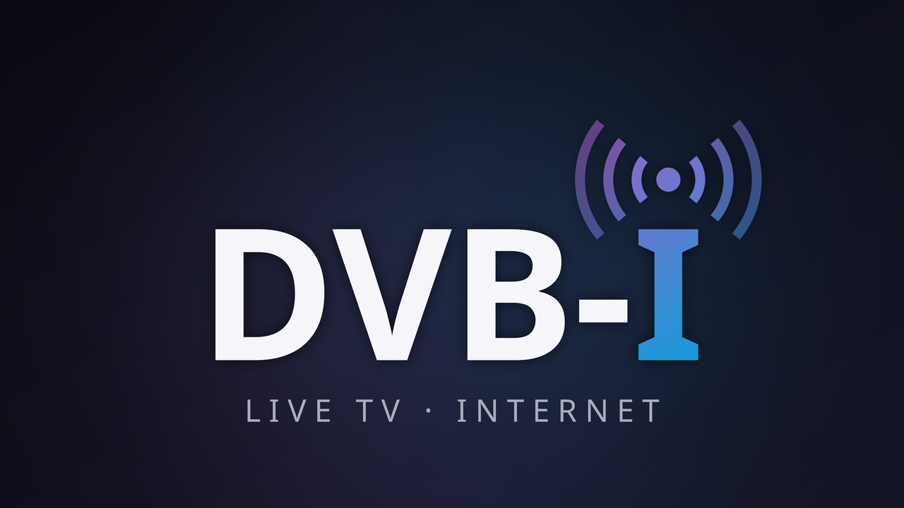

# DVB-I for Jellyfin



A Jellyfin plugin that brings **DVB-I** (ETSI TS 103 770 / DVB BlueBook A177) to Jellyfin Live TV.
DVB-I service lists describe TV and radio services together with all the ways to receive them – internet
streams (MPEG-DASH, HLS) and broadcast (DVB-T/T2, DVB-S, DVB-C) – plus a programme guide in TV-Anytime
format. The plugin turns such a service list into Jellyfin channels with a programme guide, so DVB-I feels
like any other Live TV source (comparable to an M3U tuner or TVHeadend).

> [!WARNING]
> **This project is vibe-coded.** It was written largely with an AI coding assistant, tested in one
> environment with German public broadcasters, and comes **without any warranty – use it at your own risk.**
> Suggestions, bug reports and pull requests are very welcome.

- Compatible with **Jellyfin 12.4.0** (.NET 10)
- License: GPL-3.0

## What it does

**Channels**
- Loads DVB-I service lists from a service list registry or directly by URL; several lists at once.
- Regional channel numbers: select the region by postcode or from the list's region tree; optional channel
  number offset per list.
- Every TV and radio service with an internet stream becomes a Jellyfin channel with logo and number.
- Chooses the stream by DVB-I priority and falls back to the next one on errors. Optionally prefers HLS.
- Prepares live MPEG-DASH streams for Jellyfin's ffmpeg (live edge distance, best quality,
  manifest fixes); streams are remuxed, not re-encoded.

**Programme guide**
- TV-Anytime schedules from the content guide servers named in the service list.
- Titles, episode titles, descriptions, images, genres, guide categories (movie, series, news, sports,
  kids, education), parental ratings, subtitle / audio description / sign language flags.

**Broadcast via TVHeadend (optional)**
- Plays the broadcast instances of the service list (DVB-T/T2, DVB-S, DVB-C) through a TVHeadend server,
  by DVB-I priority, with the internet stream as fallback (e.g. no free tuner).
- Services that are broadcast-only become channels as soon as TVHeadend receives them.
- Matches services by their DVB identifiers and checks the names; conflicts are reported.

**Recordings**
- Single and series recordings through Jellyfin's DVR, without re-encoding. Series are recognised even when
  broadcasters put the episode number into the title.

**Client API** for own TV clients or HbbTV integrations: original stream URLs of all instances, broadcast
parameters, HbbTV application (XML AIT) links, the DVB-I schedule with on-demand offers and "more
episodes" – see [docs/API.md](docs/API.md).

## What you need

**A DVB-I service list.** The plugin ships without any. DVB-I service lists and registries are run by
broadcasters, platform operators or national initiatives; some are public, many are only available to
partners or for trials. You need the URL of a **service list registry** (query endpoint) or of a
**service list** that you are allowed to use.

## Installation

### From the plugin repository (recommended)

1. In Jellyfin open **Dashboard → Plugins → Repositories** (in some versions: *Catalog → ⚙*) and add a
   repository:
   - Name: `DVB-I`
   - URL: `https://raw.githubusercontent.com/Bond246/jellyfin-plugin-dvbi/main/manifest.json`
2. Open the **Catalog**, select **DVB-I** under *Live TV* and install it.
3. Restart Jellyfin.

### Manually

1. Download `dvb-i_<version>.zip` (e.g. `dvb-i_1.0.1.zip`) from the [releases](https://github.com/Bond246/jellyfin-plugin-dvbi/releases).
2. Unpack it into a folder `DVB-I` inside Jellyfin's plugin directory (e.g. `/config/plugins/DVB-I/` in the
   official Docker image).
3. Restart Jellyfin.

## Configuration

Everything is configured on **Dashboard → Plugins → DVB-I** (English and German):

1. **Service list registries** – add the registry URL of your DVB-I provider and click **Show lists**,
   then **Add** a list. Alternatively add a service list directly under **Add a service list by URL**.
   Enable only one list per provider, otherwise channels appear twice.
2. **Region** – enter a **postcode** and click **Find region**, or pick the region. **Preview channels**
   shows the resulting line-up.
3. **Save.** The plugin creates the tuner and the guide provider under *Dashboard → Live TV* and starts a
   guide refresh. These entries are managed by the plugin; Jellyfin's Live TV pages cannot edit them.

### Broadcast via TVHeadend (optional)

Requirements in [TVHeadend](https://tvheadend.org/) (tested with 4.3):
- a user with **admin rights** and streaming rights (HTTP Digest or Basic authentication) – TVHeadend
  only lets administrators read the service and multiplex lists that the plugin needs for matching,
- services mapped to TVHeadend channels (streams are opened with channel tickets, so no credentials appear
  in Jellyfin's logs),
- reachable from the Jellyfin server via HTTP (default port 9981). In Docker the host name must resolve
  inside the container – often the full name or the IP address is required.

In the section **Broadcast via TVHeadend** enter address, user name and password (or **Take over from
TVHeadend plugin**), click **Test connection** – it lists the services TVHeadend delivers and any
conflicts – then enable **Prefer broadcast** and save. The TVHeadend plugin for Jellyfin is not needed for
DVB-I channels; if you keep using it, channels appear twice.

Which path is playing can be seen in the player under *Playback info → Original media info*:

| Path | Container | Video | Audio (example: German DVB-T2) |
|---|---|---|---|
| TVHeadend | `ts` | HEVC | AAC_LATM |
| Internet (DASH) | `dash` | H.264 | AAC |
| Internet (HLS) | `hls` | H.264 | AAC |

German DVB-T2 uses HEVC 1080p50 with AAC-LATM audio. Clients without support for these formats get a
transcoded stream; configure hardware acceleration in Jellyfin (*Dashboard → Playback → Transcoding*) for
this – the plugin allows it for its tuners.

## Good to know

- **Private broadcasters** are often signalled in DVB-I only as HbbTV applications or with DRM; Jellyfin
  cannot play those. Via broadcast and TVHeadend they may be available (often encrypted in HD).
- **Browsers** have no DASH player in Jellyfin's web client; Jellyfin delivers all channels as HLS.
- **Repeats** are not flagged in the guide data seen so far, so "record new episodes only" has no effect.
- **Credentials**: the TVHeadend password is stored encrypted (AES-GCM) in the plugin configuration and
  is never sent back to the configuration page. The key is kept in a separate file next to the plugin
  configuration (`plugins/configurations/Jellyfin.Plugin.DvbI.key`), so it survives reinstalling the
  plugin. This keeps the password out of the configuration file and the web UI, but not away from someone
  with access to the configuration folder. If the key file is lost, enter the password again.

## Development

```bash
dotnet build      # analyzer warnings are errors
dotnet test       # unit tests
JELLYFIN_PLUGIN_DIR=/path/to/jellyfin/config/plugins/DVB-I ./deploy.sh   # deploy into a Jellyfin Docker container
```

- Design decisions and technical background: [docs/DESIGN.md](docs/DESIGN.md)
- Notes for AI coding assistants: [AGENTS.md](AGENTS.md)
- The DVB-I specifications and XML schemas are not part of this repository (copyright of their
  publishers). Get them from [dvb.org](https://dvb.org/?standard=dvb-i-service-discovery-and-programme-metadata),
  [ETSI](https://www.etsi.org/) (TS 103 770, TS 102 323) and the
  [DVB-I reference client](https://github.com/DVBProject/DVB-I-Reference-Client) (schemas).

### Releasing

Set the plugin version `X.Y.Z.0` in `build.yaml` and `Directory.Build.props` (Jellyfin expects four
parts), then push a tag `vX.Y.Z`. The GitHub workflow builds and tests the plugin, attaches
`dvb-i_X.Y.Z.zip` to a GitHub release and adds the version to `manifest.json`.

## Contributing

Ideas, bug reports and pull requests are welcome – please open an issue first for larger changes.

## License

GPL-3.0, see [LICENSE](LICENSE).
DVB and DVB-I are trademarks of the DVB Project. This plugin is not affiliated with or endorsed by the DVB
Project, ETSI, TVHeadend or Jellyfin.
